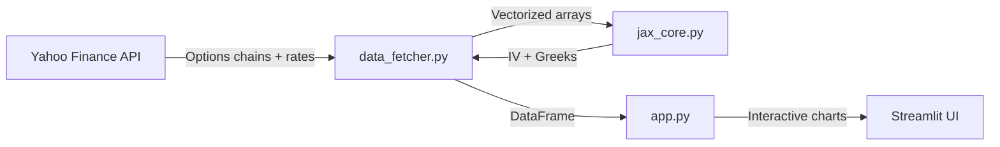

# 📈 Implied Volatility Surface — Interactive Options Analytics Engine

A **real-time implied volatility surface builder** powered by **JAX automatic differentiation** and the **Black-Scholes model**, with interactive Greeks visualization. Built as a Streamlit web application that fetches live options data from Yahoo Finance and renders publication-quality 3D surfaces and 2D volatility smile cross-sections.

> **Technologies:** Python · JAX · Streamlit · Plotly · SciPy · yfinance · Pandas · NumPy

---

## ✨ Key Features

| Feature | Description |
|---|---|
| **JAX-Accelerated IV Solver** | Vectorized Newton-Raphson implied volatility solver using `jax.vmap` and `jax.jit` — processes hundreds of options contracts in milliseconds |
| **3D Volatility Surface** | Smooth, interpolated surface (SciPy `griddata`) with Strike/Log-Moneyness vs. Time-to-Expiration axes |
| **2D Volatility Smile** | Interactive cross-section view — select any expiration date to examine the smile/skew structure |
| **Full Greeks Toolkit** | Delta, Gamma, Vega, Theta computed analytically and displayed as interactive hover tooltips on both 3D and 2D charts |
| **Auto-Fetched Market Data** | Risk-free rate (from `^TNX`) and dividend yield pulled automatically from Yahoo Finance |
| **Modular Architecture** | Clean separation of concerns: pricing engine (`jax_core`), data pipeline (`data_fetcher`), and UI (`app`) |

---

## 🖥️ Live Preview

| 3D Implied Volatility Surface | 2D Volatility Smile |
|:---:|:---:|
| Interactive surface with Greeks tooltips on hover | Cross-section at selected expiration |

> Run the app locally to see the interactive visualizations with live market data.

---

## 🧮 Mathematical Foundation

### Black-Scholes Pricing (with continuous dividends)

The core pricing engine implements the generalized Black-Scholes formula:

$$C = S \cdot e^{-qT} \cdot N(d_1) - K \cdot e^{-rT} \cdot N(d_2)$$

$$P = K \cdot e^{-rT} \cdot N(-d_2) - S \cdot e^{-qT} \cdot N(-d_1)$$

where:

$$d_1 = \frac{\ln(S/K) + (r - q + \frac{\sigma^2}{2})T}{\sigma\sqrt{T}}, \quad d_2 = d_1 - \sigma\sqrt{T}$$

| Symbol | Meaning |
|---|---|
| $S$ | Spot price |
| $K$ | Strike price |
| $r$ | Risk-free rate |
| $q$ | Continuous dividend yield |
| $T$ | Time to expiration (years) |
| $\sigma$ | Implied volatility |
| $N(\cdot)$ | Standard normal CDF |

### Newton-Raphson IV Solver

Implied volatility is extracted by iteratively solving for $\sigma$ such that $BS(\sigma) = P_{market}$:

$$\sigma_{n+1} = \sigma_n - \frac{BS(\sigma_n) - P_{market}}{\mathcal{V}(\sigma_n)}$$

where $\mathcal{V} = \partial BS / \partial \sigma$ (Vega) is computed via **JAX automatic differentiation** (`jax.grad`). The solver is fully vectorized across all contracts using `jax.vmap` and JIT-compiled for GPU/CPU acceleration.

### Greeks

All Greeks are computed analytically from the Black-Scholes model:

| Greek | Formula | Interpretation |
|---|---|---|
| **Delta** ($\Delta$) | $\pm e^{-qT} N(\pm d_1)$ | Price sensitivity to spot |
| **Gamma** ($\Gamma$) | $\frac{e^{-qT} \cdot n(d_1)}{S \sigma \sqrt{T}}$ | Delta sensitivity to spot |
| **Vega** ($\nu$) | $\frac{S \cdot e^{-qT} \cdot n(d_1) \cdot \sqrt{T}}{100}$ | Price sensitivity to IV (per 1%) |
| **Theta** ($\Theta$) | $\frac{1}{365}\left[-\frac{S\sigma e^{-qT} n(d_1)}{2\sqrt{T}} \mp rKe^{-rT}N(\pm d_2) \pm qSe^{-qT}N(\pm d_1)\right]$ | Daily time decay |

---

## 🏗️ Architecture

```
implied-volatility-surface-app/
├── app.py              # Streamlit UI — tabs, sidebar config, Plotly rendering
├── data_fetcher.py     # Yahoo Finance data pipeline + IV/Greeks orchestration
├── jax_core.py         # JAX math engine — BS pricing, IV solver, Greeks
├── requirements.txt    # Python dependencies
└── .gitignore
```

### Data Flow



| Module | Responsibility |
|---|---|
| `jax_core.py` | Pure math — Black-Scholes pricing, Newton-Raphson IV solver, analytical Greeks. All functions are `@jit` compiled and `vmap` vectorized. |
| `data_fetcher.py` | Data pipeline — fetches live options chains, filters by strike range and liquidity, orchestrates IV calculation, and returns a clean DataFrame. |
| `app.py` | Presentation layer — Streamlit sidebar configuration, `st.cache_data` for caching, SciPy grid interpolation for smooth surfaces, Plotly 3D/2D rendering with Greeks tooltips. |

---

## 🚀 Getting Started

### Prerequisites

- Python 3.10+
- pip

### Installation

```bash
# Clone the repository
git clone https://github.com/olilu67/implied-volatility-surface-app.git
cd implied-volatility-surface-app

# Create virtual environment
python -m venv .venv

# Activate (Windows)
.venv\Scripts\activate
# Activate (macOS/Linux)
source .venv/bin/activate

# Install dependencies
pip install -r requirements.txt
```

### Run

```bash
streamlit run app.py
```

The app will open at `http://localhost:8501`. Enter a ticker symbol (e.g. `SPY`, `AAPL`, `TSLA`), configure parameters in the sidebar, and click **Generate**.

---

## 📊 Usage

1. **Enter a ticker** — any US equity with listed options (e.g. `SPY`, `AAPL`, `NVDA`)
2. **Configure parameters** — option type (call/put), strike range, number of expirations
3. **Risk-free rate & dividend yield** are auto-fetched but can be overridden
4. **Click "Generate"** — the app fetches live data, computes IV & Greeks via JAX, and renders:
   - **3D IV Surface** — hover over any point to see IV, option price, and all four Greeks
   - **2D Volatility Smile** — select an expiration to view the strike-vs-IV cross-section
5. **Toggle Y-axis** between Strike Price and Log-Moneyness for different analytical perspectives

---

## 🔄 Version History

This project was developed iteratively, with each version adding meaningful functionality. The full history is preserved in Git with tagged releases and feature branches.

| Version | Tag | Highlights |
|---|---|---|
| **v1** | `v1.0` | Monolithic app — JAX Black-Scholes engine, Newton-Raphson IV solver, basic 3D scatter plot |
| **v2** | `v2.0` | SciPy `griddata` interpolation for smooth surfaces, strict strike-range filtering, improved data quality |
| **v3** | `v3.0` | Modular refactor — split into `app.py`, `data_fetcher.py`, `jax_core.py` for clean separation of concerns |
| **v4** | `v4.0` | Auto-fetched risk-free rate (`^TNX`) and dividend yield, full analytical Greeks (Δ, Γ, ν, Θ) with interactive hover tooltips |
| **v5** | `v5.0` | 2D Volatility Smile cross-section tab, `st.session_state` persistence fix, Log-Moneyness axis option |

```bash
# Checkout any version
git checkout v1.0   # Original monolith
git checkout v3.0   # After modular refactor
git checkout v5.0   # Latest with all features
```

---

## 🛠️ Technical Highlights

- **JAX** — leverages XLA compilation (`@jit`) and automatic vectorization (`vmap`) for high-performance numerical computing, with `grad` for automatic differentiation of Vega
- **Newton-Raphson convergence** — 20-iteration solver with gradient clipping (`σ ∈ [0.0001, 5.0]`) and safe-division to handle degenerate cases
- **Dual interpolation** — `scipy.griddata` with linear + nearest-neighbor fallback eliminates NaN artifacts in the 3D surface
- **Liquidity-aware pricing** — uses bid-ask midpoint when available, falls back to last trade price for illiquid options
- **Streamlit caching** — `@st.cache_data(ttl=300)` prevents redundant API calls; `st.session_state` preserves computed data across UI interactions

---

## 📄 License

This project is for educational and portfolio purposes.

---

<p align="center">
  Built with ❤️ using <b>JAX</b>, <b>Streamlit</b>, and <b>Plotly</b>
</p>
